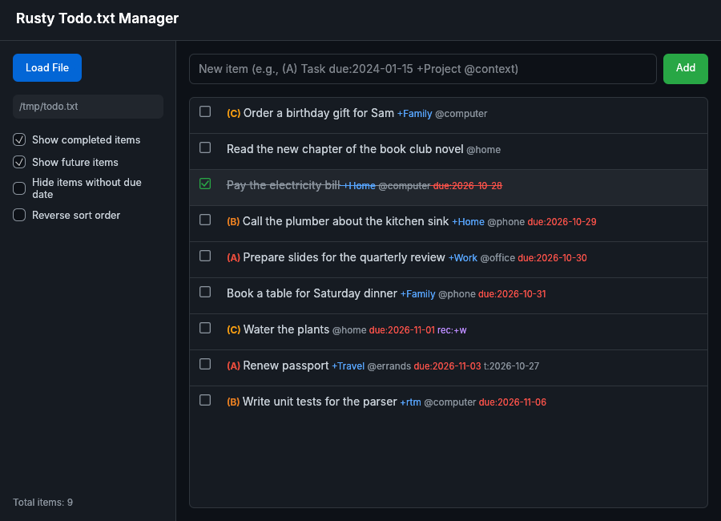

# Rusty Todo Manager

This is a [Todo.txt](https://github.com/todotxt/todo.txt) managment app, written in Rust. Very early development, but a few things already work.

Website: <https://rtm.brcha.com>.

Here are screenshots of the GUI, in the light and the dark theme:

 

and of the CLI:


## Installing

<!-- Copied to the website's install page, site/content/install.md; change both together. -->

Download the files from the latest [GitHub Release](https://github.com/brcha/rtm/releases).
`<version>` below stands for the release version, for example `26.1.0`.

### GNU/Linux (x64)

The debs install on Ubuntu 22.04 and newer and Debian 12 and newer. The RPMs install on Fedora,
RHEL 9 and 10 and their clones (AlmaLinux, Rocky Linux), and openSUSE Leap 16.0 and Tumbleweed.

Desktop app, deb:

1. Download `rtmapp_<version>_amd64.deb`.
2. Run `sudo apt install ./rtmapp_<version>_amd64.deb`. This also installs the XDG desktop portal
   with a file chooser (gtk, gnome or kde), which opening a file needs.
3. Start "Rusty Todo.txt Manager" from the application menu, or run `rtmapp`.

It runs on Wayland; X11 works with the X11 libraries the package suggests.

Desktop app, RPM:

1. Download `rtmapp-<version>-1.x86_64.rpm`.
2. Run `sudo dnf install ./rtmapp-<version>-1.x86_64.rpm` (Fedora, RHEL), or
   `sudo zypper install --allow-unsigned-rpm ./rtmapp-<version>-1.x86_64.rpm` (openSUSE). This also
   installs the XDG desktop portal with a file chooser (gtk, gnome or kde).
3. Start "Rusty Todo.txt Manager" from the application menu, or run `rtmapp`.

Desktop app, AppImage (for other distributions):

1. Download `rtmapp_<version>_amd64.AppImage`.
2. Run `chmod +x rtmapp_<version>_amd64.AppImage`.
3. Run `./rtmapp_<version>_amd64.AppImage`.

CLI:

1. Download `rtmcli_<version>_amd64.deb` or `rtmcli-<version>-1.x86_64.rpm`.
2. Run `sudo apt install ./rtmcli_<version>_amd64.deb`,
   `sudo dnf install ./rtmcli-<version>-1.x86_64.rpm` or
   `sudo zypper install --allow-unsigned-rpm ./rtmcli-<version>-1.x86_64.rpm`.
3. Run `rtmcli --help`.

### Nix and NixOS

The flake provides `rtmcli` and `rtmapp`. From a checkout, build them with `nix build .#rtmcli` and
`nix build .#rtmapp`; without one, install them into your profile with
`nix profile add github:brcha/rtm#rtmapp` (or `#rtmcli`).

`github:brcha/rtm` follows `main`, the development branch. To install a release instead, name a
release tag or a release branch:

- `github:brcha/rtm/v<version>`: that release, which never changes, for example
  `nix profile add github:brcha/rtm/v<version>#rtmapp`.
- `github:brcha/rtm/releases/v<line>`: the branch of a release line, for example `releases/v26.1`
  for the 26.1 releases. It gets the line's fixes as soon as they are merged, before their patch
  release; `nix profile upgrade rtmapp` updates to it.

To try a release without installing it, run it:
`nix run github:brcha/rtm/v<version>#rtmcli -- --help`.

To install them on NixOS from a flake-based configuration:

1. Add the `rtm` input to your system `flake.nix`, following your `nixpkgs`, which must have rustc
   1.95 or later (`nixos-26.05` does). For a release, use one of the references above as its `url`.
2. Add the packages to `environment.systemPackages` (or to `home.packages` with Home Manager):

   ```nix
   {
     inputs = {
       nixpkgs.url = "github:NixOS/nixpkgs/nixos-26.05";
       rtm = {
         url = "github:brcha/rtm";
         inputs.nixpkgs.follows = "nixpkgs";
       };
     };

     outputs = { nixpkgs, rtm, ... }: {
       nixosConfigurations.myhost = nixpkgs.lib.nixosSystem {
         system = "x86_64-linux";
         modules = [
           ./configuration.nix
           ({ pkgs, ... }: {
             environment.systemPackages = with rtm.packages.${pkgs.stdenv.hostPlatform.system}; [
               rtmapp
               rtmcli
             ];
           })
         ];
       };
     };
   }
   ```

3. Run `sudo nixos-rebuild switch --flake .#myhost`, then start "Rusty Todo.txt Manager" from the
   application menu, or run `rtmapp` or `rtmcli --help`.

### macOS (Apple Silicon and Intel)

Universal binaries for macOS 11 (Big Sur) and later. They are signed ad hoc only, not with an Apple
Developer ID, and not notarized, so Gatekeeper blocks them until you allow them.

Desktop app:

1. Download `rtmapp_<version>_universal.dmg` and open it.
2. Drag "Rusty Todo.txt Manager" to Applications.
3. Open the app from Applications. macOS 15 refuses with this dialog, which has no Open button:

   > **“Rusty Todo.txt Manager” Not Opened**
   >
   > Apple could not verify “Rusty Todo.txt Manager” is free of malware that may harm your Mac or
   > compromise your privacy.

   Click **Done**. (Earlier macOS versions word the dialog differently.)
4. Open System Settings > Privacy & Security, scroll down to Security, and click **Open Anyway**
   next to the message about "Rusty Todo.txt Manager".
5. Authenticate, then click **Open** in the dialog that follows. Later launches open normally.

Instead of steps 3 to 5, you can remove the quarantine attribute in Terminal:

```sh
xattr -dr com.apple.quarantine "/Applications/Rusty Todo.txt Manager.app"
```

On macOS 14 and earlier, Control-click the app and choose **Open** also works; macOS 15 removed
that shortcut.

The app's settings are in `~/Library/Application Support/rtm/config.toml`.

CLI:

1. Download `rtmcli-<version>-macos-universal.tar.gz` and extract it:
   `tar -xzf rtmcli-<version>-macos-universal.tar.gz`.
2. Remove the quarantine attribute: `xattr -d com.apple.quarantine rtmcli` ("No such xattr" means
   there was none; carry on).
3. Move it to a directory on your `PATH`, for example
   `sudo mkdir -p /usr/local/bin && sudo mv rtmcli /usr/local/bin/`, or `~/.local/bin` if that is
   on your `PATH`.
4. Run `rtmcli --help`.

### Windows (x64)

The packages are unsigned, so Windows warns before running them.

Desktop app:

1. Download `rtmapp_<version>_x64_en-US.msi` and open it.
2. If SmartScreen shows "Windows protected your PC", click **More info**, then **Run anyway**.
3. Follow the installer. It installs to `Program Files` and needs administrator rights: the UAC
   prompt shows "Unknown publisher"; click **Yes**. The Start Menu and desktop shortcuts can be
   deselected.
4. Start "Rusty Todo.txt Manager" from the Start Menu.

The installer replaces an installed older version, including the Tauri-based releases up to 0.1.3,
and keeps its install folder.

CLI:

1. Download `rtmcli-<version>-x64.exe`. It is a portable binary; there is no installer.
2. Optionally rename it to `rtmcli.exe`.
3. Move it to a folder on your `PATH`, or add its folder to `PATH`: Start > "Edit environment
   variables for your account" > `Path` > **Edit** > **New**.
4. Open a new terminal and run `rtmcli --help`.

ARM64 and 32-bit Windows builds are not currently produced.

## Syncing through Git or Pijul

`rtmcli` and the desktop app sync your todo.txt when it is tracked in a Git or Pijul repository.
Nothing to set up: rtmcli pulls before every command and commits and pushes every change. The
desktop app commits every change at once and syncs (pulls, then pushes) in the background: when it
opens the file, every 10 minutes, when you click **Sync now** in its title bar, and when you close
it. Editing never waits for a sync. Set `sync_interval_minutes` in `rtm/config.toml` to change the
interval, or to 0 to sync only on open, on close and on demand.

- Commit the todo.txt to the repository once (`git add todo.txt` and commit, or `pijul add` and
  `pijul record`), or let rtm do it: rtmcli with `--commit-changes`, the desktop app when it asks
  on open. rtm never adds an untracked file on its own. rtmcli reminds you of an untracked todo.txt
  on every run, and the desktop app asks every time it opens it; ignore the file in the repository
  (`.gitignore`, or `.ignore` for Pijul) to silence them; rtm then never syncs it.
- If the todo.txt has changes rtm did not commit (edited by hand, or with `--no-sync`), rtmcli
  stops before syncing: commit or revert them, or run it with `--commit-changes` to commit them
  first. The desktop app asks when it opens the file: commit them, or leave the file closed to
  commit or revert them yourself.
- Without a remote (no upstream branch for Git), changes are committed but not pushed.
- `rtmcli sync` only pulls and pushes. `--no-sync` (or `RTM_NO_SYNC=1`) works on the file without
  committing, pulling or pushing; in the desktop app, put `sync = false` in `rtm/config.toml` in
  your config folder. If the folder holds both a Git and a Pijul repository, choose with `--vcs git`
  or `--vcs pijul` (or `RTM_VCS`); the desktop app asks and remembers the answer.
- Offline, changes are still saved and committed, with a "Not synced" warning; the next sync pushes
  them.
- If a pull conflicts, rtm stops (the desktop app closes the file) and leaves the conflict for you
  to resolve in the repository (for Git: fix the file, `git add` it and `git rebase --continue`).
- rtm uses the `git` or `pijul` you already have, with your SSH keys and credential helpers, and
  never asks for a password. For an HTTPS remote, set up a git credential helper (Git Credential
  Manager, `osxkeychain`, `libsecret`, ...); otherwise use an SSH remote with `ssh-agent`.

## General plan

- [x] Implement basic functionality of the Todo.txt manager with CLI and desktop GUI (for GNU/Linux, Mac OS X and Windows, since I use all of those).
- [x] Create cloud synchronisation for the Todo.txt files (ideas welcome, my plan is to setup a private git repo, which is what I currently use anyway). Done through Git or Pijul, see [Syncing through Git or Pijul](#syncing-through-git-or-pijul).
- [ ] Make a mobile GUI for the library (Android centric, but hopefully cross platform).
- [ ] Add subtasks as a concept (already provided uuid and sub tags for todo.txt items, needs implementation in cli/ui)
- [ ] Add comments for items (using uuid and some comment storage, probably specific subdir of the todotxt git-managed directory)

## License

[MIT](https://brcha.mit-license.org/@2023)
