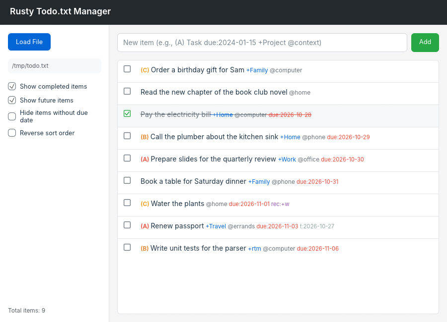
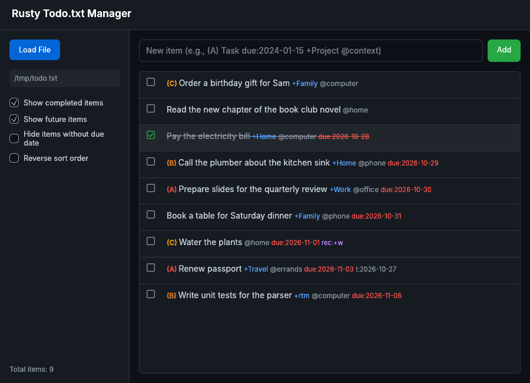
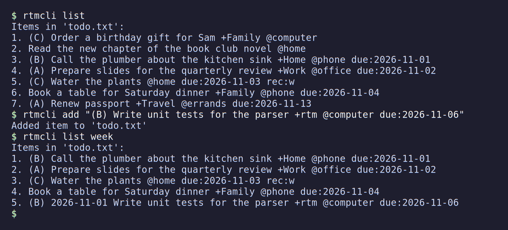

# Rusty Todo Manager

[](https://github.com/brcha/rtm/actions/workflows/rust.yml?query=branch%3Amain)
[](https://github.com/brcha/rtm/actions/workflows/nix.yml?query=branch%3Amain)
[](https://github.com/brcha/rtm/actions/workflows/site.yml?query=branch%3Amain)
[](https://github.com/brcha/rtm/releases)
[](LICENSE)
[](https://github.com/brcha/rtm/releases)
[](https://deps.rs/repo/github/brcha/rtm)
[](#nix-and-nixos)
[](https://rtm.brcha.com)

A [Todo.txt](https://github.com/todotxt/todo.txt) management app written in Rust, with a desktop
app and a command-line program for GNU/Linux, macOS and Windows. It is released and in daily use,
and still under active development.

Website: <https://rtm.brcha.com>.

What works today:

- A desktop app (`rtmapp`, egui) and a CLI (`rtmcli`), built on one shared library (`todotxt`).
- [Several todo.txt files](#several-files-in-the-desktop-app) open at once in the desktop app, one
  tab each.
- [Projects and contexts](#projects-and-contexts): listed with their open-item counts and used as
  filters, in both programs.
- [Syncing](#syncing-through-git-or-pijul) a todo.txt through its Git or Pijul repository.
- [AI assistants](#using-rtm-with-ai-assistants-mcp) (Claude Desktop, Claude Code and other MCP
  clients) reading and changing your todo.txt, through `rtmcli` or the desktop app.
- [Update checks](#updates) against the website, with stable and beta channels.
- [Packages](#installing): deb, RPM and AppImage for GNU/Linux, a DMG for macOS, an MSI for
  Windows, and a [Nix flake](#nix-and-nixos).

Here are screenshots of the GUI, in the light and the dark theme:

 

and of the CLI:



## Installing

<!-- Copied to the website's install page, site/content/install.md; change both together. -->

Download the files from the latest [GitHub Release](https://github.com/brcha/rtm/releases).
`<version>` below stands for the release version, for example `26.1.0`.

### GNU/Linux (x64)

The debs install on Ubuntu 22.04 and newer and Debian 12 and newer. The RPMs install on Fedora,
RHEL 9 and 10 and their clones (AlmaLinux, Rocky Linux), and openSUSE Leap 16.0 and Tumbleweed.

Desktop app, deb:

1. Download `rtmapp_<version>_amd64.deb`.
2. Run `sudo apt install ./rtmapp_<version>_amd64.deb`. This also installs the XDG desktop portal
   with a file chooser (gtk, gnome or kde), which opening a file needs.
3. Start "Rusty Todo.txt Manager" from the application menu, or run `rtmapp`.

It runs on Wayland; X11 works with the X11 libraries the package suggests.

Desktop app, RPM:

1. Download `rtmapp-<version>-1.x86_64.rpm`.
2. Run `sudo dnf install ./rtmapp-<version>-1.x86_64.rpm` (Fedora, RHEL), or
   `sudo zypper install --allow-unsigned-rpm ./rtmapp-<version>-1.x86_64.rpm` (openSUSE). This also
   installs the XDG desktop portal with a file chooser (gtk, gnome or kde).
3. Start "Rusty Todo.txt Manager" from the application menu, or run `rtmapp`.

Desktop app, AppImage (for other distributions):

1. Download `rtmapp_<version>_amd64.AppImage`.
2. Run `chmod +x rtmapp_<version>_amd64.AppImage`.
3. Run `./rtmapp_<version>_amd64.AppImage`.

CLI:

1. Download `rtmcli_<version>_amd64.deb` or `rtmcli-<version>-1.x86_64.rpm`.
2. Run `sudo apt install ./rtmcli_<version>_amd64.deb`,
   `sudo dnf install ./rtmcli-<version>-1.x86_64.rpm` or
   `sudo zypper install --allow-unsigned-rpm ./rtmcli-<version>-1.x86_64.rpm`.
3. Run `rtmcli --help`.

### Nix and NixOS

The flake provides `rtmcli` and `rtmapp`. From a checkout, build them with `nix build .#rtmcli` and
`nix build .#rtmapp`; without one, install them into your profile with
`nix profile add github:brcha/rtm#rtmapp` (or `#rtmcli`).

`github:brcha/rtm` follows `main`, the development branch. To install a release instead, name a
release tag or a release branch:

- `github:brcha/rtm/v<version>`: that release, which never changes, for example
  `nix profile add github:brcha/rtm/v<version>#rtmapp`.
- `github:brcha/rtm/releases/v<line>`: the branch of a release line, for example `releases/v26.1`
  for the 26.1 releases. It gets the line's fixes as soon as they are merged, before their patch
  release; `nix profile upgrade rtmapp` updates to it.

To try a release without installing it, run it:
`nix run github:brcha/rtm/v<version>#rtmcli -- --help`.

To install them on NixOS from a flake-based configuration:

1. Add the `rtm` input to your system `flake.nix`, following your `nixpkgs`, which must have rustc
   1.95 or later (`nixos-26.05` does). For a release, use one of the references above as its `url`.
2. Add the packages to `environment.systemPackages` (or to `home.packages` with Home Manager):

   ```nix
   {
     inputs = {
       nixpkgs.url = "github:NixOS/nixpkgs/nixos-26.05";
       rtm = {
         url = "github:brcha/rtm";
         inputs.nixpkgs.follows = "nixpkgs";
       };
     };

     outputs = { nixpkgs, rtm, ... }: {
       nixosConfigurations.myhost = nixpkgs.lib.nixosSystem {
         system = "x86_64-linux";
         modules = [
           ./configuration.nix
           ({ pkgs, ... }: {
             environment.systemPackages = with rtm.packages.${pkgs.stdenv.hostPlatform.system}; [
               rtmapp
               rtmcli
             ];
           })
         ];
       };
     };
   }
   ```

3. Run `sudo nixos-rebuild switch --flake .#myhost`, then start "Rusty Todo.txt Manager" from the
   application menu, or run `rtmapp` or `rtmcli --help`.

### macOS (Apple Silicon and Intel)

Universal binaries for macOS 11 (Big Sur) and later. They are signed ad hoc only, not with an Apple
Developer ID, and not notarized, so Gatekeeper blocks them until you allow them.

Desktop app:

1. Download `rtmapp_<version>_universal.dmg` and open it.
2. Drag "Rusty Todo.txt Manager" to Applications.
3. Open the app from Applications. macOS 15 refuses with this dialog, which has no Open button:

   > **“Rusty Todo.txt Manager” Not Opened**
   >
   > Apple could not verify “Rusty Todo.txt Manager” is free of malware that may harm your Mac or
   > compromise your privacy.

   Click **Done**. (Earlier macOS versions word the dialog differently.)
4. Open System Settings > Privacy & Security, scroll down to Security, and click **Open Anyway**
   next to the message about "Rusty Todo.txt Manager".
5. Authenticate, then click **Open** in the dialog that follows. Later launches open normally.

Instead of steps 3 to 5, you can remove the quarantine attribute in Terminal:

```sh
xattr -dr com.apple.quarantine "/Applications/Rusty Todo.txt Manager.app"
```

On macOS 14 and earlier, Control-click the app and choose **Open** also works; macOS 15 removed
that shortcut.

The app's settings are in `~/Library/Application Support/rtm/config.toml`.

CLI:

1. Download `rtmcli-<version>-macos-universal.tar.gz` and extract it:
   `tar -xzf rtmcli-<version>-macos-universal.tar.gz`.
2. Remove the quarantine attribute: `xattr -d com.apple.quarantine rtmcli` ("No such xattr" means
   there was none; carry on).
3. Move it to a directory on your `PATH`, for example
   `sudo mkdir -p /usr/local/bin && sudo mv rtmcli /usr/local/bin/`, or `~/.local/bin` if that is
   on your `PATH`.
4. Run `rtmcli --help`.

### Windows (x64)

The packages are unsigned, so Windows warns before running them.

Desktop app:

1. Download `rtmapp_<version>_x64_en-US.msi` and open it.
2. If SmartScreen shows "Windows protected your PC", click **More info**, then **Run anyway**.
3. Follow the installer. It installs to `Program Files` and needs administrator rights: the UAC
   prompt shows "Unknown publisher"; click **Yes**. The Start Menu and desktop shortcuts can be
   deselected.
4. Start "Rusty Todo.txt Manager" from the Start Menu.

The installer replaces an installed older version, including the Tauri-based releases up to 0.1.3,
and keeps its install folder.

CLI:

1. Download `rtmcli-<version>-x64.exe`. It is a portable binary; there is no installer.
2. Optionally rename it to `rtmcli.exe`.
3. Move it to a folder on your `PATH`, or add its folder to `PATH`: Start > "Edit environment
   variables for your account" > `Path` > **Edit** > **New**.
4. Open a new terminal and run `rtmcli --help`.

ARM64 and 32-bit Windows builds are not currently produced.

### Updates

The desktop app checks for a newer release a few seconds after it starts and once a day while it
runs. When one exists, a notice under the title bar offers it: **Download** opens the release's
page, where you download it as you did the first time; the × hides the notice until the next start.
`rtmcli check-update` does the same check on demand and prints the release's page; it is the only
rtmcli command that uses the network.

Each check is one request for `https://rtm.brcha.com/releases.json`, with no version or identifier,
so the website sees only your IP address. Turn the desktop app's check off in **Settings** ("Check
for updates", stored as `check_for_updates = false` in `rtm/config.toml`). To be offered beta
releases too, choose the Beta channel there (`update_channel = "beta"`), or run
`rtmcli check-update --channel beta`. The Nix packages have no update check; update them through
your flake inputs.

## Several files in the desktop app

The desktop app keeps several todo.txt files open, one tab each above the list. **New File** and
**Load File** (in the menu at the left of the title bar, or under the **+** after the tabs) add a
tab, or show the file's tab when it is already open; with no file open, as at the first start, the
page itself offers both. The × that appears on a tab under the pointer
closes it, after asking. The app reopens the same tabs at the next start and shows the one you
last clicked. They are saved in `rtm/config.toml` as `[[files]]` tables, one per tab, each with
the file's `path`. To label a tab, right-click it and choose **Rename tab**; the label is saved as
the entry's `name`, and an empty one shows the file name again. The file itself keeps its name.
`file_name` names the shown file, so an older version of the app still opens that one. Each file syncs through its own repository. To move an item, with its sub-items, to
another open file, use **Move to…** in its edit dialog.

## Projects and contexts

`rtmcli projects` and `rtmcli contexts` list every `+project` and `@context` in the todo.txt, each
with the number of open items that carry it:

```
$ rtmcli projects
Projects in 'todo.txt':
+garden (0)
+home (1)
+work (3)
```

Names are compared without regard to case: `+Work` and `+work` are one project, shown as first
spelled in the file. A tag with `(0)` is found only on completed items.

`rtmcli list` takes projects and contexts as filters, in any order and next to a due-date filter
(`today`, `week`, `all`, `overdue`, `future`); an item must match all of them, and `-c` lists
completed items instead of open ones:

```
$ rtmcli list +work @phone today
```

In PowerShell, quote contexts (`'@phone'`): an unquoted `@phone` is read as a PowerShell variable
and the argument disappears.

The desktop app lists the projects and contexts of the shown file in its sidebar, with the same
open-item counts, in Projects and Contexts sections that collapse from their headers (the app
remembers which ones are collapsed). Click tags there to filter the list: an item must carry every
selected tag, a second click removes a tag, and **Clear filter** shows everything again. Each
tab keeps its own selection until the app closes. A tag in an item row works the same way: click
it to add it to the filter or remove it, and click the rest of the item to edit it. A link in an
item's text (`http://`, `https://` or `mailto:`) is underlined; click it to open it in your
browser or mail program.

## Syncing through Git or Pijul

`rtmcli` and the desktop app sync your todo.txt when it is tracked in a Git or Pijul repository.
Nothing to set up: rtmcli pulls before every command and commits and pushes every change. The
desktop app commits every change at once and syncs (pulls, then pushes) in the background: when it
opens the file, every 10 minutes, when you click **Sync now** in its title bar, and when you close
it. Editing never waits for a sync. Change the interval in **Settings** (the menu at the left of its
title bar), or set it to 0 to sync only on open, on close and on demand; it is stored as
`sync_interval_minutes` in `rtm/config.toml`.

- Commit the todo.txt to the repository once (`git add todo.txt` and commit, or `pijul add` and
  `pijul record`), or let rtm do it: rtmcli with `--commit-changes`, the desktop app when it asks
  on open. rtm never adds an untracked file on its own. rtmcli reminds you of an untracked todo.txt
  on every run, and the desktop app asks every time it opens it; ignore the file in the repository
  (`.gitignore`, or `.ignore` for Pijul) to silence them; rtm then never syncs it.
- If the todo.txt has changes rtm did not commit (edited by hand, or with `--no-sync`), rtmcli
  stops before syncing: commit or revert them, or run it with `--commit-changes` to commit them
  first. The desktop app asks when it opens the file: commit them, or leave the file closed to
  commit or revert them yourself.
- Without a remote (no upstream branch for Git), changes are committed but not pushed.
- `rtmcli sync` only pulls and pushes. `--no-sync` (or `RTM_NO_SYNC=1`) works on the file without
  committing, pulling or pushing; in the desktop app, turn off "Sync through the file's
  repository" in **Settings** (stored as `sync = false` in `rtm/config.toml`). If the folder holds
  both a Git and a Pijul repository, choose with `--vcs git` or `--vcs pijul` (or `RTM_VCS`); the
  desktop app asks and remembers the answer.
- Offline, changes are still saved and committed, with a "Not synced" warning; the next sync pushes
  them.
- If a pull conflicts, rtm stops (the desktop app closes the file) and leaves the conflict for you
  to resolve in the repository (for Git: fix the file, `git add` it and `git rebase --continue`).
- rtm uses the `git` or `pijul` you already have, with your SSH keys and credential helpers, and
  never asks for a password. For an HTTPS remote, set up a git credential helper (Git Credential
  Manager, `osxkeychain`, `libsecret`, ...); otherwise use an SSH remote with `ssh-agent`.

## Using rtm with AI assistants (MCP)

Both programs include an [MCP](https://modelcontextprotocol.io) server, so an AI assistant such as
Claude Desktop or Claude Code can list your items, projects and contexts, and add, edit, complete,
reopen and delete items. Use whichever program you installed:

- `rtmcli mcp` serves one file, from `-f` or `$TODOTXT`.
- `rtmapp mcp` serves the files open in the desktop app (its `[[files]]` in `rtm/config.toml`), the
  shown one first, and picks up files you add or rename there. The app does not need to be running,
  and no window opens.

Add exactly one rtm server to each client, `rtmcli mcp` or `rtmapp mcp`, not both, and name it
`rtm`. A second rtm server in the same client offers no tools.

Clients may start the server without your shell's environment. Pass the variables it needs
explicitly (`-e` in Claude Code, `env` in Claude Desktop): `TODOTXT`, `RTM_NO_SYNC` and `RTM_VCS`
for `rtmcli mcp`, and `XDG_CONFIG_HOME` for `rtmapp mcp` if you set it (GNU/Linux), so that it finds
`rtm/config.toml`.

The server runs on your computer and talks to the client over stdin and stdout. It uses the network
only to sync with your repository's remote; the items the assistant reads reach its AI service like
anything else you show it. It can use only the files listed above, never a path the assistant
names. Changes are saved and synced as rtmcli saves and syncs them: each change is committed and
pushed at once when the file is in a Git or Pijul repository (see
[Syncing](#syncing-through-git-or-pijul)), and the desktop app, if it is open, shows them.
Deleting is marked as destructive, so clients that confirm tool calls ask you first.

Where the programs are:

| Installed from | `rtmcli`                            | `rtmapp`                                                         |
|----------------|-------------------------------------|------------------------------------------------------------------|
| deb, RPM       | `/usr/bin/rtmcli`                   | `/usr/bin/rtmapp`                                                |
| AppImage       |                                     | the `.AppImage` file itself, wherever you keep it                |
| macOS          | where you moved it                  | `/Applications/Rusty Todo.txt Manager.app/Contents/MacOS/rtmapp` |
| Windows        | where you moved it                  | `C:\Program Files\Rusty Todo.txt Manager\rtmapp.exe`             |
| Nix profile    | `~/.nix-profile/bin/rtmcli`         | `~/.nix-profile/bin/rtmapp`                                      |
| NixOS system   | `/run/current-system/sw/bin/rtmcli` | `/run/current-system/sw/bin/rtmapp`                              |

### Claude Code

```sh
claude mcp add --scope user rtm -- rtmcli mcp -f ~/todo.txt
```

or, for the desktop app's files, `claude mcp add --scope user rtm -- rtmapp mcp` (on macOS, the full
path from the table). `--scope user` makes it available in every directory; without it, only in the
current one. On Windows, quote paths with spaces:
`claude mcp add --scope user rtm -- "C:\Program Files\Rusty Todo.txt Manager\rtmapp.exe" mcp`.
Environment variables go before the name: `claude mcp add --scope user -e RTM_VCS=git rtm -- ...`.

### Claude Desktop

Open **Settings > Developer > Edit Config**, which opens `claude_desktop_config.json`
(`~/Library/Application Support/Claude/` on macOS, `%APPDATA%\Claude\` on Windows), and add the
server under `mcpServers`:

```json
{
  "mcpServers": {
    "rtm": {
      "command": "/usr/local/bin/rtmcli",
      "args": ["-f", "/Users/me/todo.txt", "mcp"]
    }
  }
}
```

or, for the desktop app's files:

```json
{
  "mcpServers": {
    "rtm": {
      "command": "/Applications/Rusty Todo.txt Manager.app/Contents/MacOS/rtmapp",
      "args": ["mcp"]
    }
  }
}
```

Then restart Claude Desktop. Claude Desktop does not start the server from a shell, so:

- Use absolute paths for the command and the file: `~` and environment variables are not expanded.
  On Windows, write backslashes twice (`"C:\\Users\\me\\todo.txt"`).
- Your shell's environment does not reach the server. Put the variables it needs (see above) in an
  `env` object next to `args`, for example `"env": {"RTM_VCS": "git"}`. `rtmapp mcp` takes its
  other settings, sync included, from `rtm/config.toml`.
- Syncing runs the `git` or `pijul` on the `PATH` the client gives the server. If yours is
  elsewhere (Homebrew's `/opt/homebrew/bin`, for example), set `PATH` in `env` too; without it,
  changes are saved but not synced.

### Other clients

Any MCP client that starts local servers over stdio works the same way: the command is `rtmcli`
with the arguments `-f <file> mcp`, or `rtmapp` with `mcp`.

## General plan

- [x] Implement basic functionality of the Todo.txt manager with CLI and desktop GUI (for GNU/Linux, macOS and Windows, since I use all of those).
- [x] Create cloud synchronisation for the Todo.txt files (ideas welcome, my plan is to setup a private git repo, which is what I currently use anyway). Done through Git or Pijul, see [Syncing through Git or Pijul](#syncing-through-git-or-pijul).
- [x] MCP server for AI assistants. Done in `rtmcli mcp` and `rtmapp mcp`, see [Using rtm with AI assistants (MCP)](#using-rtm-with-ai-assistants-mcp).
- [ ] Make a mobile GUI for the library (Android centric, but hopefully cross platform).
- [ ] Add subtasks as a concept (already provided uuid and sub tags for todo.txt items, needs implementation in cli/ui)
- [ ] Add comments for items (using uuid and some comment storage, probably specific subdir of the todotxt git-managed directory)

## License

[MIT](https://brcha.mit-license.org/@2023)
