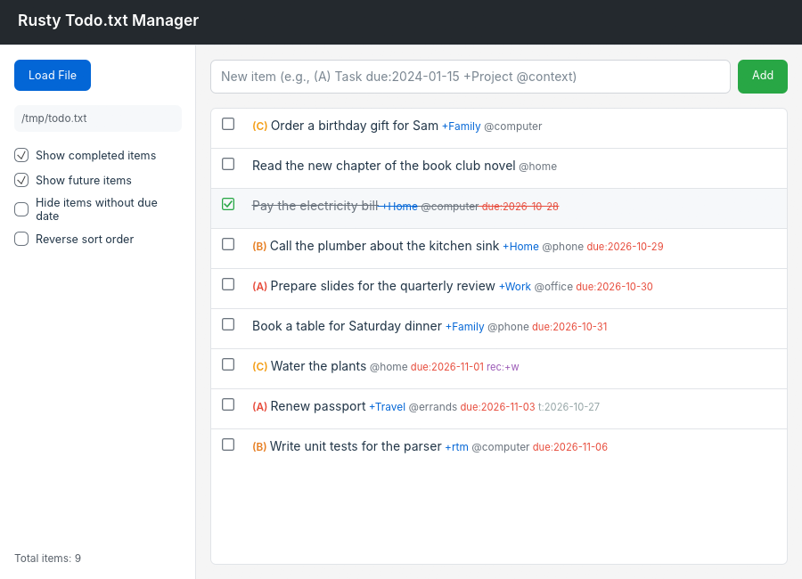
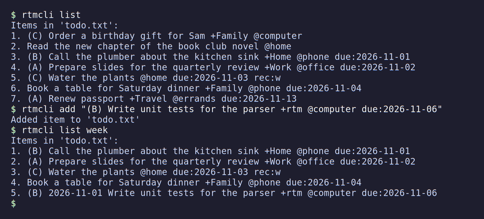

# Rusty Todo Manager

This is a [Todo.txt](https://github.com/todotxt/todo.txt) managment app, written in Rust. Very early development, but a few things already work.

Here's a screenshot of the GUI:

and of the CLI:

## Installing

### Windows (x64)

Grab the latest release from [GitHub Releases](https://github.com/brcha/rtm/releases):

- **`rtmapp_<version>_x64_en-US.msi`** — installer for the desktop GUI. Requires administrator
  rights (installs to `Program Files`); the Start Menu and desktop shortcuts can be deselected. It
  replaces an installed older version, including the Tauri-based releases up to 0.1.3, and keeps
  its install folder. The installer is currently unsigned, so Windows SmartScreen and the UAC
  prompt will show an "Unknown publisher" warning — this is expected for now.
- **`rtmcli-<version>-x64.exe`** — portable CLI binary.

ARM64 and 32-bit Windows builds are not currently produced.

### GNU/Linux (x64)

From the same releases, built on Ubuntu 22.04 and installable there and on newer Debian-based
systems:

- **`rtmapp_<version>_amd64.deb`** — the desktop GUI (`sudo apt install ./rtmapp_<version>_amd64.deb`).
  Runs on Wayland; X11 works with the X11 libraries the package suggests. Opening a file needs the XDG
  desktop portal with a file chooser (gtk, gnome or kde), which the package pulls in.
- **`rtmapp_<version>_amd64.AppImage`** — the same GUI as a single file, for other distributions.
- **`rtmcli_<version>_amd64.deb`** — the CLI.

Nix users can build both from the flake (`nix build .#rtmcli` / `nix build .#rtmapp`).

### macOS

Not yet packaged for release. Build from source (see `AGENTS.md` and the per-component `AGENTS.md`
files).

## General plan

- [ ] Implement basic functionality of the Todo.txt manager with CLI and desktop GUI (for GNU/Linux, Mac OS X and Windows, since I use all of those).
- [ ] Create cloud synchronisation for the Todo.txt files (ideas welcome, my plan is to setup a private git repo, which is what I currently use anyway)
- [ ] Make a mobile GUI for the library (Android centric, but hopefully cross platform).
- [ ] Add subtasks as a concept (already provided uuid and sub tags for todo.txt items, needs implementation in cli/ui)
- [ ] Add comments for items (using uuid and some comment storage, probably specific subdir of the todotxt git-managed directory)

## License

[MIT](https://brcha.mit-license.org/@2023)
